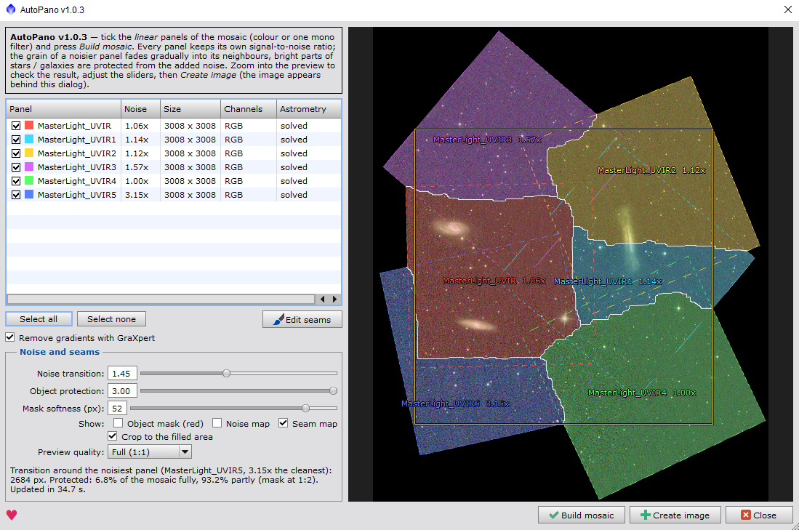

# AutoPano for PixInsight

**Seamless deep-sky mosaics in one click.**



## Why

Anyone who has assembled a mosaic in PixInsight knows the routine: plate-solve every panel, run a chain of tools one after another, adjust, repeat. Even then the result often gives away where the panels meet:

- a **visible seam** — a line or a step in brightness or colour;
- a **patch of different grain** — one panel had fewer subs or a worse night, and its noise stands out;
- a **seam right through a galaxy**, or **doubled stars** where the panels overlap;
- an **awkward crop** — the finished mosaic is tilted, and cutting off the empty corners loses a big part of the field.

AutoPano does all of this for you. Open the stacked panels, tick them, press **Build mosaic** — and get one smooth image, as if it had been shot in one frame.

## What you get

- **No visible seams.** Panels are matched in brightness and colour, and joined along lines that run through empty sky, around stars and galaxies.
- **Even noise.** A noisier panel doesn't stand out as a patch: its grain fades gradually into its neighbours. Your best panels keep their quality, and bright parts of galaxies and stars stay clean.
- **Any panel layout.** Panels can be rotated in any direction, shot on different nights, or come without coordinates — AutoPano finds their place itself, accurate to a fraction of a pixel.
- **See exactly what you get.** The preview shows the final mosaic; zoom in to 1:1 and move the sliders — no rebuilding.
- **Seam map.** Shows which panel each part of the mosaic comes from and how noisy each panel is.
- **Seam brush.** Want a galaxy taken from your cleanest panel? Paint over it — the seams reroute around your stroke by themselves.
- **Maximum field after cropping.** The mosaic is built at the angle that leaves the largest rectangle without empty corners. One tick crops it — with no extra quality loss, and with the sky coordinates still exact.
- **Strong gradients.** For light pollution or Moon glow, one tick runs GraXpert on every panel first (if you have it installed).
- **Forgiving.** If a panel doesn't fit — no overlap, or no common stars — AutoPano tells you why and builds the mosaic from the rest.

The result is a linear 32-bit image with an astrometric solution, ready for your usual processing.

## Installation

1. In PixInsight: **Resources › Updates › Manage Repositories › Add** and paste
   ```
   https://raw.githubusercontent.com/BananAndrews/AutoPano/main/repository/
   ```
2. **Resources › Updates › Check for Updates**, install, restart PixInsight.
3. Run it from **Script › Utilities › AutoPano**.

Needs PixInsight 1.9.5 or newer. Updates arrive through **Check for Updates**. The repository is not signed yet, so PixInsight asks for confirmation once.

## How to use

1. Open the panels: stacked, **unstretched** masters — colour, or one filter of a mono set (build each filter separately).
2. Tick them and press **Build mosaic**.
3. Check the preview, adjust the sliders if you like, press **Create image**. The window stays open, so you can try other settings.

| Setting | What it does |
|---|---|
| Noise transition | how wide the zone is where the grain of a noisier panel fades into its neighbours |
| Object protection | how strongly bright parts of galaxies and stars are kept clean |
| Mask softness | how soft the edges of that protection are |
| Show: object mask / noise map / seam map | helper overlays on the preview |
| Crop to the filled area | crop to the largest rectangle without empty corners (the frame is shown on the preview) |
| Use GraXpert | for strong gradients only; AutoPano suggests it when it sees them |
| Edit seams | the seam brush: pick a panel (in the list or Ctrl+click on the preview) and paint where it should be used. Alt — eraser, Ctrl+Z / Ctrl+Shift+Z — undo / redo, *Apply* — rebuild |

Settings are remembered between runs.

## Tips

- An overlap of 15–20 % or more gives the seams room to go around objects.
- Memory: about 4 GB for six colour panels of 3000 × 3000 px.

## Feedback

AutoPano is new. If something doesn't work as expected, please open an issue here (or write in the forum thread) with the console log and a screenshot.

## Support

AutoPano is free. If it helped you — **[♥ support the author via PayPal](https://www.paypal.com/donate/?business=contact%40bluebelleweddings.com&no_recurring=0&item_name=AutoPano)** (the same heart is in the script window, where you can also pay by card).

## License

Free to use; all rights reserved. Modification and redistribution of modified versions are not permitted — see [LICENSE](LICENSE).

---

# AutoPano для PixInsight

**Бесшовные мозаики дип-скай одной кнопкой.**

## Зачем

Кто собирал мозаику в PixInsight, знает, как это обычно выглядит: решить астрометрию каждой панели, прогнать цепочку инструментов один за другим, подкрутить, повторить. И даже после этого по результату часто видно, где стыкуются панели:

- **заметный шов** — линия или ступенька по яркости и цвету;
- **«заплатка» с другим зерном** — у одной панели меньше кадров или ночь была хуже, и её шум бросается в глаза;
- **шов прямо через галактику** или **двоящиеся звёзды** на перекрытии;
- **обидная обрезка** — готовая мозаика лежит наискосок, и, отрезая пустые углы, теряешь заметную часть поля.

AutoPano делает всё это сам. Открываете сложенные панели, отмечаете галочками, жмёте **Build mosaic** — и получаете одну ровную картинку, как будто она снята одним кадром.

## Что вы получаете

- **Никаких видимых швов.** Панели выравниваются по яркости и цвету, а стыкуются по линиям, которые идут по пустому небу в обход звёзд и галактик.
- **Ровный шум.** Шумная панель не выделяется пятном: её зерно плавно переходит в соседние. Лучшие панели не теряют качества, а яркие части галактик и звёзд остаются чистыми.
- **Любая раскладка панелей.** Панели могут быть повёрнуты как угодно, сняты в разные ночи или вообще без координат — AutoPano сам найдёт их место с точностью до долей пикселя.
- **Видно, что получится.** Превью показывает готовую мозаику; можно приблизить до 1:1 и двигать ползунки без пересборки.
- **Карта швов.** Показывает, из какой панели взят каждый участок мозаики и насколько шумная каждая панель.
- **Кисть швов.** Хотите, чтобы галактика была взята с самой чистой панели? Закрасьте её — швы сами обойдут мазок.
- **Максимум поля после обрезки.** Мозаика собирается под таким углом, чтобы прямоугольник без пустых углов был самым большим. Обрезка — одной галочкой, без дополнительной потери качества, а небесные координаты остаются точными.
- **Сильные градиенты.** При засветке или свете Луны одна галочка сначала прогонит каждую панель через GraXpert (если он установлен).
- **Не ломается на мелочах.** Если какая-то панель не стыкуется — нет перекрытия или общих звёзд, — AutoPano скажет почему и соберёт мозаику из остальных.

На выходе — линейное 32-битное изображение с астрометрией, готовое к обычной обработке.

## Установка

1. В PixInsight: **Resources › Updates › Manage Repositories › Add**, вставьте адрес
   ```
   https://raw.githubusercontent.com/BananAndrews/AutoPano/main/repository/
   ```
2. **Resources › Updates › Check for Updates**, установите, перезапустите PixInsight.
3. Скрипт — в **Script › Utilities › AutoPano**.

Нужен PixInsight 1.9.5 или новее. Обновления приходят через **Check for Updates**. Репозиторий пока не подписан, поэтому PixInsight один раз попросит подтверждение.

## Как пользоваться

1. Откройте панели: сложенные **нерастянутые** мастера — цветные или один фильтр моно-сета (каждый фильтр собирается отдельно).
2. Отметьте их и нажмите **Build mosaic**.
3. Посмотрите превью, при желании подвигайте ползунки и нажмите **Create image**. Окно не закрывается — можно попробовать другие настройки.

| Настройка | Что делает |
|---|---|
| Noise transition | ширина зоны, в которой зерно шумной панели плавно переходит в соседние |
| Object protection | насколько сильно яркие части галактик и звёзд остаются чистыми |
| Mask softness | мягкость краёв этой защиты |
| Show: object mask / noise map / seam map | вспомогательные слои на превью |
| Crop to the filled area | обрезка до максимального прямоугольника без пустых углов (рамка видна на превью) |
| Use GraXpert | только для сильных градиентов; AutoPano сам подскажет, когда он нужен |
| Edit seams | кисть швов: выберите панель (в списке или Ctrl+щелчком на превью) и закрасьте, где её брать. Alt — ластик, Ctrl+Z / Ctrl+Shift+Z — отмена / повтор, *Apply* — пересобрать |

Настройки запоминаются между запусками.

## Советы

- Перекрытие панелей 15–20 % и больше даёт швам место обойти объекты.
- Память: около 4 ГБ на шесть цветных панелей 3000 × 3000 px.

## Обратная связь

AutoPano новый. Если что-то работает не так, как ожидалось, создайте issue здесь (или напишите в ветке на форуме) и приложите лог консоли и скриншот.

## Поддержка

AutoPano бесплатный. Если он вам помог — **[♥ поддержите автора через PayPal](https://www.paypal.com/donate/?business=contact%40bluebelleweddings.com&no_recurring=0&item_name=AutoPano)** (такое же сердечко есть в окне скрипта, там можно оплатить и картой).

## Лицензия

Пользоваться бесплатно; все права защищены. Изменять скрипт и распространять изменённые версии нельзя — см. [LICENSE](LICENSE).
